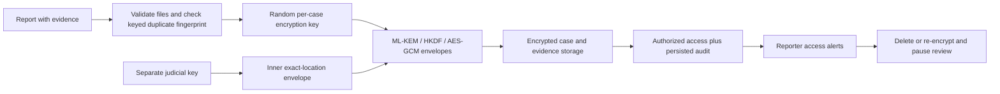

# SentinelQ: features, cryptography and presentation guide

Updated October 13, 2026. This describes the implemented project, including the reporter protection update. The initial gap analysis and execution checklist are in [REQUIREMENTS_PLAN.md](REQUIREMENTS_PLAN.md). Older audit documents describe earlier versions.

## Answers to the requested checks

| Question | Verified behavior |
| --- | --- |
| Can somebody submit without proof? | New submissions require at least one validated, nonempty attachment. Blank TXT files, empty files, malformed base64, unsupported formats and excessive uploads are rejected. The old text-only `/report` route cannot bypass the requirement. |
| Is lattice-based / post-quantum cryptography really used? | Yes. Stored data uses ML-KEM-768, HKDF-SHA512 and AES-256-GCM; stored case manifests and downloadable evidence receipts use ML-DSA-65. These are real cryptographic operations, exercised by tamper and interoperability tests. |
| Is reporting location hidden and recoverable with a key? | The optional exact-location field has an inner encryption envelope derived from the separate judicial key and an outer case-key envelope. Ordinary authority and reporter responses omit the ciphertext and plaintext. Admin/court viewers supply the correct judicial key and a reason to decrypt it. |
| Does the reporter get access alerts? | Persisted, authenticated access history appears in Track a case. It refreshes every 10 seconds while the page is visible and unlocked; access during an absence appears on return. Alerts identify the account, role, operation and time. |
| Does the death switch delete the complaint? | Yes: it removes live complaint contents, messages, notes, location envelopes, case keys, original/review evidence, retired case artifacts and recorded viewer photos. It revokes outstanding grants. Minimal signed deletion and audit metadata remain. |
| Can it preserve the complaint under a new key? | Yes: it generates a new random case encryption key, re-encrypts sensitive fields/messages/evidence, replaces the recovery key, revokes grants, retires old ciphertext and pauses authority review. The reporter can resume review with the replacement recovery key. |
| Are repeat complaints rejected? | Yes: the server compares a keyed fingerprint of the normalized original narrative plus incident date against stored records, including deletion tombstones. Changes to the title, filename, case of letters, punctuation or spacing do not bypass it. Submission-token retries return the original receipt instead of creating another case. |

An attachment is supporting material, not proof of truth. A valid hash/signature establishes integrity of submitted bytes and records; it does not establish that an event happened, identify an offender, or detect fabricated media. Investigators still assess authenticity, relevance and independent corroboration. The evidence requirement is a project policy and can exclude genuine complainants who cannot safely obtain a file; that tradeoff should be discussed in the presentation.

## Full implemented feature inventory

### Reporter experience

- No reporter account or compulsory name/contact field. A random Case ID and high-entropy recovery key provide pseudonymous follow-up access.
- Required title, narrative and supporting evidence; optional incident date and separately encrypted exact location. The application does not automatically collect GPS coordinates.
- Advisory privacy warnings and an editable, rule-based anonymization suggestion. Users must review and apply the suggestion themselves; identifiers can still survive.
- File uploads, camera photos, video and microphone recordings. Shared limits: five attachments, 8 MiB per file and 8 MiB combined, plus a bounded request size.
- JPEG, PNG, MP4, WebM, WAV, MP3, M4A, OGG, PDF and TXT intake. File extensions, basic format signatures and transfer encodings are validated; this is not malware scanning or forensic authenticity detection.
- Immediate receipt after encrypted persistence, with durable background masking and bounded retries for slow media. No need to keep the upload page open after receiving the receipt.
- A recovery-key receipt with hide/reveal/copy controls and a downloadable ML-DSA signed evidence receipt containing original file hashes and sizes.
- Recovery-based status/timeline viewing and encrypted-at-rest two-way messages. Existing legacy records remain readable.
- Access alerts, acknowledgement, pagination through older events, emergency deletion, key replacement, and explicit review resumption.
- Inactivity locking, Quick exit and clearing of sensitive state when leaving the page. Quick exit cannot erase browser history, downloads, screenshots or network logs.

### Authority experience

- Admin, case manager, investigator, auditor and court roles, with account password verification and expiring, revocable sessions.
- Case list/search/filtering, case detail, deterministic category and priority suggestions, and role-aware actions.
- Administrators/managers update status and priority and assign an investigator. Investigators can access only assigned cases. Internal notes are separate from reporter messages.
- Case messages, redacted summary downloads, evidence integrity checks and similar-case review leads. Similarity never increases integrity scores or proves corroboration.
- Masked evidence downloads; PDFs and failed/unprocessed derivatives remain unavailable for ordinary review.
- Personal original-access keys for admin/court accounts, fresh session-bound viewer-photo challenges, access reasons and references, and single-use grants lasting at most 60 seconds.
- Separate judicial-key access to sensitive fields and exact location. Ordinary login alone cannot decrypt the inner location envelope.
- Verified audit history and authorized review of recorded viewer photos. A recorded photo is an accountability artifact, not biometric identity verification.
- Coarse aggregate counts by category, priority and region. These are not differentially private statistics.

### Evidence and infrastructure

- SHA3-256 hashes for original and sanitized bytes, authenticated encryption, an HMAC-authenticated evidence ledger, and ML-DSA signed case manifests.
- Coarse full-frame image/video blur; altered audio voices; text copies masked with `X`. Original evidence stays restricted. Speech identifiers are not automatically removed, and full-frame blur sacrifices useful detail.
- An authenticated audit chain covering application-mediated case/evidence access and workflow changes.
- Local file storage and a backend-only Supabase adapter. Private object storage, RLS-enabled database tables and no browser access to the service secret.
- Optimistic revision checks, serialized intake in the supported single-process deployment, request/credential limits, bounded inputs, CORS restrictions and secure response headers.
- Production frontend build and a single verification command covering backend tests, build and dependency audits.
- Optional external analysis only with explicit per-request consent; a deterministic local fallback otherwise. No claim of validated automated truth detection.

## How the cryptography fits together



**ML-KEM-768** is a module-lattice key encapsulation mechanism: it establishes a secret used to derive an AES key. **AES-256-GCM** encrypts the payload and checks its authenticity. **HKDF-SHA512** separates key purposes. **ML-DSA-65** signs the stored case and reporter receipt. Case/artifact/field identity is authenticated as additional data, so ciphertext copied into another context fails verification. ML-KEM and ML-DSA are specified by [NIST FIPS 203](https://csrc.nist.gov/pubs/fips/203/final) and [NIST FIPS 204](https://csrc.nist.gov/pubs/fips/204/final). The application is not FIPS certified.

New complaints receive a random 256-bit case key, wrapped by the platform master key. The platform still holds the material to unwrap it. Exact location is additionally sealed under a case-specific key derived from `SENTINELQ_JUDICIAL_ACCESS_KEY`; possession of the ordinary case key alone does not open that inner envelope. Existing sensitive fields other than exact location keep their established server encryption plus judicial authorization gate.

Emergency replacement changes the case key itself and all current case/evidence ciphertext, not just the password hash. Messages are re-encrypted. Location's outer encryption changes; the independently configured judicial key remains the same. The replacement reporter key is generated in the browser and must be saved before the request, so a lost response need not strand the reporter. The API stores its verifier, not the plaintext replacement key. A high-entropy operation token permits a retry of the same completed action without making the old recovery key valid again.

Deletion commits a signed tombstone without the complaint key or contents, then removes encrypted objects. Rotation commits new references before removing old objects. Signed cleanup journals survive crashes; incomplete cleanup returns `202` with `cleanupPending`, retries every 30 seconds while the service is running, and resumes at startup. Case-scoped artifact enumeration also finds abandoned evidence versions. Stale workers cannot publish evidence for an erased or replaced key generation. The original immutable audit/ledger chains remain intact.

Historical cases without per-case keys use their old shared storage key until explicit rotation. Rotation upgrades their current data where readable; independently court-sealed `SQC1` originals require custodian migration first. Do not change the global storage/audit secret to rotate one complaint, and do not use the historical migration script for that purpose.

## What access alerts cover

Alerts cover successful application-mediated case-list disclosure, case detail and summary reads, messages, evidence verification, masked/shared/original evidence access, original-access requests/grants/denials, judicial-detail access, viewer-photo review and audited case updates. Each event is persisted before the corresponding successful release. A shared-link event identifies its issuing account; it cannot identify the person holding that bearer link. The reporter's own tracking and system masking do not generate authority alerts.

This is an authenticated in-app inbox, not an email/SMS/background-push service. Tracking refreshes pause when the tab is hidden and stop when the case is closed or locked after inactivity. Historical events remain available on return. No system can observe an administrator reading a previously downloaded file, taking a screenshot, reading a backup directly, or bypassing the application on a compromised host. Such actions do not generate these alerts.

## Duplicate prevention and its limits

The fingerprint is an HMAC over Unicode-normalized, lowercased narrative text with normalized whitespace/punctuation, plus incident date. It is compared against the database before evidence writes. The digest is not returned to ordinary clients, and rejection never reveals the existing Case ID, recovery key or report. Serializing intake prevents two identical simultaneous submissions from winning in the supported one-Node-process deployment. The existing submission-token mechanism distinguishes a network retry from a new complaint.

This rejects exact normalized repeats, not every paraphrase or dishonest new incident date. Identical generic narratives/dates can also collide at the policy level even though they concern different incidents. Independent descriptions sharing an evidence file remain possible; shared bytes alone do not prove abuse. Larger deployments need an indexed, transactionally unique fingerprint in Postgres, shared rate limits and a human appeal/review policy before adding multiple Node instances.

## Why this is useful for crime reporting and insider leakage in India

Suggested presentation answer:

> SentinelQ addresses two practical barriers to reporting: fear of exposing the reporter and lack of visibility into who handles the complaint. It reduces routine disclosure through pseudonymous case access, encrypted evidence, masked review copies and separately protected location. Role and assignment checks limit which staff can review a case. Signed records and access alerts make application activity accountable, while emergency deletion or key replacement gives the reporter a way to respond to suspicious access. Required supporting material and duplicate checks improve the quality of intake. These measures can reduce opportunities for casual internal disclosure and make tampering easier to detect, while keeping the reporter involved through secure follow-up messages.

That is a technical design rationale, not evidence that the prototype has reduced crime or stopped government corruption in practice. An authorized viewer can still copy information, and a host administrator can bypass server-managed controls. Effective protection also needs independent custody, accountable institutions, operational monitoring and appropriate reporting procedures.

India already has official channels: the [National Cyber Crime Reporting Portal](https://www.cybercrime.gov.in/Webform/Index.aspx) accepts cybercrime complaints. Government PIDPI guidance also recognizes confidentiality of whistleblower identity; see [ICAR's PIDPI information](https://icar.gov.in/en/public-interest-disclosure-and-protection-informers-pidpi). SentinelQ is an independent project, not an official portal, FIR service, automatic police referral or a substitute for the requirements of those schemes. Its pseudonymous process does not by itself make a complaint valid under an official scheme.

## Faculty ideas: implemented demonstration and future work

| Idea | What to demonstrate | Status / tradeoff |
| --- | --- | --- |
| Portable post-quantum evidence receipt | Download a receipt, verify it offline, change one byte in its claims and show verification failing | Implemented in this update. A trusted/preserved key fingerprint is needed to authenticate the issuer; an included public key alone is not an independent trust anchor. |
| Cryptographic key replacement with a visible access pause | Show the old recovery key failing, the saved new key working, new ciphertext rejecting the old case key, and authority access remaining paused | Implemented and covered by automated tests. It cannot erase copies or backups already held elsewhere. |
| Two-of-three independent custodians | Require two separately controlled holders, such as court/oversight/privacy officers, to release a key | Future work. Use a reviewed threshold design and separate organizations/devices; three keys held on the same server would not achieve that separation. |
| Merkle transparency checkpoints | Export a signed batch root, preserve it with an independent witness and prove that a receipt was included without exposing other reports | Future work. Privacy and deletion implications must be designed before publishing commitments. |
| Selective-disclosure credentials or zero-knowledge eligibility proofs | Prove an approved eligibility attribute without publishing the reporter's full identity | Future research. Requires a trustworthy issuer, a precise threat model and a reviewed proof system; it does not prove the allegation true. |
| Differentially private hotspot statistics | Explore trends while limiting what an aggregate reveals about one report | Future work. Requires calibrated noise, suppression of tiny groups and a privacy budget; ordinary rounded counts are insufficient. |

For the strongest current demo, combine the signed receipt, wrong-key location rejection, access alerts and emergency rotation. Show a successful verification and a deliberate tamper failure, and explain exactly what each proves.

## Demonstration walkthrough

1. Use synthetic data. Attempt a submission without evidence; the UI disables it and the API independently refuses it.
2. Submit a harmless TXT file with an incident description, date and optional exact location. Save the Case ID/recovery key and download the signed receipt.
3. Submit the same narrative/date with changed title, spacing or filename; show rejection. Retry the same submission token in an API test; show a single receipt.
4. Log in as an authority. Show the masked location and restricted original evidence. Use the configured judicial key and a reason to reveal exact location.
5. Return to Track a case. Show the authority's access history and mark the alerts reviewed.
6. Choose key replacement, save the newly displayed key, and type the Case ID. Show that the old key fails and authority review is paused. Resume review using the replacement key.
7. On a disposable synthetic complaint, demonstrate deletion. Explain the remaining minimal audit/deletion metadata and the backup/download limits.
8. Verify the receipt offline with the public-key fingerprint preserved at submission:

```powershell
node scripts/verify-receipt.js "C:\path\to\receipt.json" "ml-dsa-65:<trusted fingerprint>"
```

## Security boundaries and deployment requirements

- This is platform-managed encryption at rest, not browser-to-court end-to-end encryption, network anonymity, post-quantum TLS or protection against a compromised host. The server receives plaintext uploads and holds key material.
- Exact location protection applies to its dedicated field. Location typed into the narrative, message text, filenames or evidence can still be revealed through the relevant access path. Do not put exact coordinates in the ordinary narrative when demonstrating location privacy.
- Deletion preserves a minimal signed tombstone: case reference, deletion time, keyed duplicate fingerprint, operation digest and any pending encrypted-object cleanup references. Audit/ledger history can retain case references, actors, reasons, timestamps and evidence digests. It does not preserve the deleted complaint's encryption key or contents in the live case record.
- Erasure does not guarantee forensic destruction of disk remnants, provider backups, historical database versions, memory snapshots or already downloaded copies. A managed key service and a tested backup-retention policy are production requirements.
- Access alerts and emergency actions depend on the application and storage being reachable. Already delivered or in-flight plaintext cannot be recalled. Possession of a recovery key authorizes destructive reporter controls, so keep it private.
- Set an independent, high-entropy `SENTINELQ_JUDICIAL_ACCESS_KEY` before submitting location. Existing encrypted locations require the original judicial key; changing that environment variable alone is not a location-key migration.
- No new SQL schema is required: new fields and minimal tombstones use the existing signed JSONB payload and revision RPC. Object cleanup uses the private Storage API. No client privileges or public buckets are added. Cloud adapter behavior is tested locally; a live deployed smoke check remains separate.
- Keep one Node application process for this version. Intake/case coordination, sessions, grants and rate limits are in process memory; a horizontally scaled deployment needs database/shared coordination first.

## Implementation map and verification

| Area | Main implementation |
| --- | --- |
| Intake, role gates, location reveal, access events | `backend/index_no_deps.js` |
| Key domains, location envelopes, fingerprints and receipts | `backend/reporter-security.js` |
| Emergency actions, journals and reporter alert history | `backend/reporter-controls.js` |
| Lattice encryption/signatures, key cache eviction | `backend/post-quantum.js`, `backend/case-integrity.js` |
| Local/cloud persistence and scoped object cleanup | `backend/storage.js` |
| Stale media-job fencing | `backend/evidence-worker.js` |
| Reporter UI and proof/location fields | `frontend/src/ReporterSafety.jsx`, `frontend/src/App.jsx` |
| Receipt download and offline verification | `frontend/src/SecurityStatus.jsx`, `scripts/verify-receipt.js` |
| New regression and failure tests | `backend/test/reporter-controls.test.js`, `backend/test/reporter-controls-failures.test.js` |

Run `node scripts/verify-mvp.js` from the project root. The final run record is in [REQUIREMENTS_PLAN.md](REQUIREMENTS_PLAN.md). The tests exercise real lattice ciphertext/signatures, wrong keys and tampering, restart persistence, duplicate races, access isolation, old-key/grant invalidation, erasure, partial-write recovery and object-store outages using disposable synthetic vaults.
