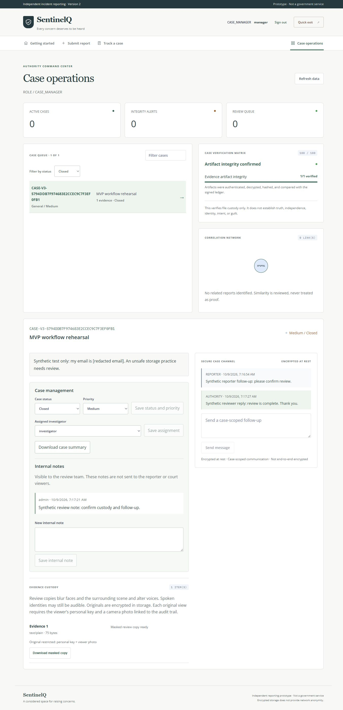

# SentinelQ MVP submission handoff

**October 13 update:** use [the requirement audit and verification record](REQUIREMENTS_PLAN.md) and [the complete feature and faculty-demo guide](FEATURES_AND_SECURITY.md) for the latest mandatory-evidence, location, duplicate, reporter-alert and emergency-key features. The October 9 results below document the earlier submission baseline.

**Handoff date:** October 9, 2026. **Scope:** controlled demonstration with synthetic data. This is the current submission guide; `SENTINELQ_AUDIT.md`, `FUNCTIONALITY_AUDIT.md`, `FINAL_PRODUCT_AUDIT.md`, `QA_COMPLETION_REPORT.md`, and `PHASE3_SUMMARY.md` are historical records and are superseded.

SentinelQ connects pseudonymous report intake to recovery-based follow-up and role-based authority review. New stored evidence, messages, viewer photos, and sensitive case fields use lattice-based ML-KEM-768 with HKDF-SHA512 and AES-256-GCM. ML-DSA-65 protects case manifests against unauthorized modification. These protections operate on the server; they do not hide network activity or make the application end-to-end encrypted.

The final interface polish provides explicit reporter/dashboard refresh, status and priority editing, investigator assignment, internal review notes, and a downloadable redacted case summary. Review controls follow the signed-in role. Loading and failure messages explain pending actions, and switching cases clears the previous conversation while the next one loads.

## Reproduce the local demo

1. Install Node.js 22.13 or newer, npm, FFmpeg, and FFprobe. Put the media executables on PATH, or set `SENTINELQ_FFMPEG_PATH` and `SENTINELQ_FFPROBE_PATH` in the shell used for verification.
2. For a new local installation, copy `backend/.env.example` to `backend/.env` and replace every placeholder. Use different random values for each secret. Do not overwrite an existing `.env` or regenerate storage/audit keys for an existing vault. No external AI account, Supabase account, or custodian enrollment is required for the local demo.
3. From the repository root, run:

   ```powershell
   npm --prefix backend ci
   npm --prefix frontend ci
   node scripts/verify-mvp.js
   ```

4. Start the API with `npm --prefix backend start`. In a second terminal run `npm --prefix frontend start`. Open `http://localhost:3000`. The API binds to `127.0.0.1:4000` by default. The frontend rebuilds when started; after source changes, restart it to rebuild.
5. Use the local `admin`, `manager`, `investigator`, and `auditor` accounts with the corresponding passwords from your private `.env`. Admins can create separate court accounts through the viewer account panel. Save generated viewer keys securely; they are shown only once.

The verifier uses temporary fixture storage and does not read application `.env`, migrate data, start the real application, or deploy. It stops before the test suite when media prerequisites are missing, so a skipped media test cannot look like a complete submission check. It returns nonzero on test/build/audit failures; audits need network access. `node scripts/verify-mvp.js --preflight` checks only prerequisites. Do not run multiple suites together: existing fixtures use ports 4100–4103 and 4118 as well as temporary ports.

## Demonstration walkthrough

Allow approximately ten minutes. Use a fictional incident and harmless sample image/audio/text files; avoid showing credentials, saved keys, or real allegations on the projector.

1. **Introduction:** open Getting started and explain the report/recovery/review journey. State that this is an independent prototype and does not hide network activity.
2. **Submit a report:** enter a meaningful title and incident description; review the advisory identity warnings. Attach a small image and text file, or record a short synthetic clip. Submit, then save the Case ID and recovery key before leaving the receipt.
3. **Recover and reply:** open Track a case, enter those credentials, confirm the report status and evidence-processing state, and send a reporter follow-up. A wrong recovery key must be rejected without revealing the report.
4. **Review as an authority:** sign in as admin/manager, find the case, inspect the masked evidence and custody-integrity signals, and save its status and priority. Assign an investigator, add an internal note, and download the redacted case summary. Send an authority reply, then recover the report again and use Refresh case and messages to see it. The reporter must not see the internal note. Similar reports are investigation leads; they are not proof or an integrity-score boost.
5. **Explain cryptography:** show the security/capability description and [POST_QUANTUM.md](POST_QUANTUM.md). Identify ML-KEM-768 for the stored encryption envelope and ML-DSA-65 for case signatures. Clarify that old artifacts remain in their historical format until explicitly rewritten.
6. **Accountable original viewing:** use an admin/court account with a saved personal access key, choose Request original, enter the key, reference and reason, and capture a fresh viewer photo. Confirm the preview opens and closes; then inspect the access event and photo from an admin/auditor session. This requires a working camera; it does not prove the viewer's identity.
7. **Role boundary and exit:** show an investigator only their assigned cases and a read-only reviewer their allowed view. Sign out and confirm privileged access ends. Demonstrate Quick exit after closing any sensitive preview; browser history and server data are not erased.

## Workflow coverage map

These are the source-level workflows and regression suites used for submission assessment. A listed suite is a coverage reference, not a claim that a physical device or hosted service was tested.

| Workflow | Expected behavior | Primary regression coverage |
| --- | --- | --- |
| Report intake and recovery | Valid submission returns a durable receipt; recovery secret opens only its own case; bounded invalid requests fail safely | `basic.test.js`, `audit.test.js`, `evidence-intake.test.js`, `v2-security.test.js` |
| Reporter/authority messaging | Authorized participants can exchange case-scoped messages, encrypted in storage | `audit.test.js`, `pqc-integration.test.js`, `security.test.js` |
| Evidence capture/upload | Correct binary transfer, supported-type/size validation, device release on cancel/error | `capture.test.js`, `capture-lifecycle.test.js`, `evidence-intake.test.js` |
| Masking and durable processing | Blur/voice alteration/text mask create review copies; failures/PDFs remain restricted; jobs survive retry/restart | `media.test.js`, `worker.test.js`, `v2-security.test.js` |
| Access, triage, assignment, notes | Permissions and investigator assignment enforced server-side; invalid operations rejected | `mvp-workflows.test.js`, `security.test.js`, `audit.test.js`, `v2-security.test.js` |
| Original viewing and audit photos | Personal key, session-bound fresh challenge, photo, reference/reason, and one-use grant are required | `media.test.js`, `evidence-intake.test.js`, `v2-security.test.js` |
| Post-quantum storage/integrity | New ciphertext/signatures authenticate; modified or swapped records fail; historical formats remain readable | `post-quantum.test.js`, `pqc-integration.test.js`, `case-integrity.test.js` |
| Persistence and audit | Local/cloud adapter behavior, conditional updates, signed logs, and storage errors fail safely | `storage.test.js`, `case-integrity.test.js`, `v2-security.test.js` |
| Frontend delivery and session safety | CSP/static delivery, session expiry, quick exit, and client request isolation | `frontend.test.js`, `browser-security.test.js` plus browser walkthrough |

All suite paths are relative to `backend/test`. Legacy custodian tests validate compatibility tools; their existence does not mean the old custodian enrollment flow is part of new report intake.

## Verification record

The integrated verification command completed successfully on October 9, 2026. These results apply to this local source revision and its installed dependencies; historical audit counts are not current evidence.

| Check | Result |
| --- | --- |
| Runtime/media prerequisites | PASS — Node.js 24.18.0, npm 12.0.1, FFmpeg and FFprobe available |
| Backend regression suite | PASS — 116 tests; 0 failed, skipped, or cancelled |
| Frontend production build | PASS — rebuilt successfully after the final interface cleanup |
| Backend and frontend dependency audits | PASS — 0 reported vulnerabilities in either dependency tree |
| Browser workflow walkthrough | PASS — isolated local service, synthetic data; details below |
| Actual presentation device camera/microphone | Requires rehearsal on the chosen device |
| Hosted deployment of this final revision | Not deployed or validated by this local handoff |

The browser walkthrough verified report submission with TXT evidence, privacy redaction, a v3 receipt, recovery access, and two-way messages. An administrator moved the case from Open through In Review to Closed, changed its priority, assigned an investigator, saved an internal note, and downloaded both the summary and masked TXT copy; downloaded contents were checked. Explicit refresh preserved the saved state. The judicial-details reveal/hide flow recorded `JUDICIAL_DETAILS_ACCESS` in the audit.

Investigator access was limited to the assigned case. Auditor controls excluded status changes, notes, chat, and original access while retaining audit review; manager controls matched their role. Open/Closed filters produced the expected case/empty states. The reporter saw the final Closed status and both replies after refresh, and Clear case removed the recovery key. Quick exit navigated to `about:blank`.

The walkthrough produced zero browser error/warning logs. At 390×844 and 1366×900, document scroll width matched viewport width, with no horizontal overflow. Physical cameras and microphones were not enabled during this walkthrough; media capture and viewer-photo/grant behavior are covered by automated fixtures and still need rehearsal on the presentation device.

The [final desktop screenshot](qa/mvp-dashboard.jpg) uses synthetic data and shows no credentials:



## Submission boundaries and known limits

- **Cryptography:** server-managed PQC storage and case signatures, not post-quantum TLS, FIPS certification, forward secrecy, or protection against host/storage-key compromise. Audit and evidence-ledger chains use HMAC. Keep current keys; this release requires no new secret or bulk data migration.
- **Privacy:** full-frame blur and altered voices can retain identifying speech/context; PDFs and failed derivatives remain quarantined. Original-access photos support accountability, not liveness or biometric identity. Authorized viewers receive original bytes. Quick exit clears interface state, not browser history, logs, or backups.
- **Workflow scope:** no reporter account/recovery-key reset, no new evidence attachment after initial report, and no self-service viewer-key recovery/rotation. Losing a report recovery key can prevent reporter access; losing a viewer key requires operator-managed account recovery.
- **AI:** privacy/categorization helpers are advisory rules by default. External analysis is optional and requires explicit per-request consent; it is not a truth detector and is not required for the demo.
- **Operations:** one Node process; sessions, rate limits, and grants are in memory. Cloud adapter tests do not prove a live deployment works. Production work remains for backup/restore, retention, monitoring, MFA, transaction coordination, and independently anchored audit history. See [DEPLOYMENT.md](DEPLOYMENT.md), [DATABASE.md](DATABASE.md), and [EVIDENCE_PRIVACY.md](EVIDENCE_PRIVACY.md).

Submit source, lockfiles, and documentation. Exclude `.env`, storage keys, real case data, viewer photos, `backend/data`, `node_modules`, logs, and private custodian material. Use synthetic screenshots, and perform the device rehearsal before presenting. A hosted submission additionally needs the final revision deployed and checked over HTTPS; that is separate from the local verification command.
